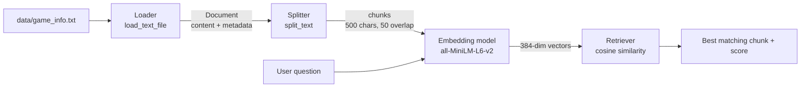

# rag_intro

A minimal, from-scratch introduction to the **retrieval** half of RAG (Retrieval-Augmented Generation).
It loads a text file, cuts it into overlapping chunks, turns each chunk into an embedding, and finds the chunk that best answers a question using cosine similarity.

No vector database and no LLM yet. Every step is plain Python, so each stage is easy to read and change.

## Architecture



### Indexing

| Stage | Code | Input | Output |
|---|---|---|---|
| 1. Load | `load_text_file()` | path to a `.txt` file | `Document` with `content` and `metadata` (`source`, `char_count`) |
| 2. Split | `split_text()` | full text | list of 500-character chunks, each overlapping the previous by 50 characters |
| 3. Embed | `SentenceTransformer("all-MiniLM-L6-v2").encode()` | list of chunks | one 384-number vector per chunk |

### Retrieval

| Stage | Code | What happens |
|---|---|---|
| 4. Embed the question | `model.encode(query)` | The question becomes a 384-number vector in the same space as the chunks. |
| 5. Score | `util.cos_sim(query_embedding, chunk_embeddings)` | Each chunk gets a similarity score; higher means closer in meaning. |
| 6. Select | `similarity_scores.argmax()` | The chunk with the highest score is returned as the answer context. |

### Why overlap?

The splitter moves forward by `chunk_size - chunk_overlap` (500 - 50 = 450 characters).
Each chunk then repeats the last 50 characters of the one before it, so a sentence that falls on a boundary still appears whole in at least one chunk.

```
text:     |---------------------------------------------------------|
chunk 1:  [0 ............ 500]
chunk 2:            [450 ............ 950]
chunk 3:                       [900 ............ 1400]
```

## Project structure

```
.
├── code.py              # Loader, splitter, embedding and retrieval demo
└── data/
    └── game_info.txt    # Sample knowledge base (Valorant agents and abilities)
```

## Running it

Requires Python 3.10+.

```bash
python -m venv .venv
.venv\Scripts\activate        # Windows
# source .venv/bin/activate   # macOS / Linux
pip install sentence-transformers
python code.py
```

`code.py` sets `HF_HUB_OFFLINE=1`, so the `all-MiniLM-L6-v2` model has to be in your local Hugging Face cache already.
On the first run, remove that line, or set the variable to `0`, so the model can download.

Example output:

```
Total chunks created: 20
Loading embedding model...
Calculating embeddings for all chunks...

User Question: 'Which character can heal or revive a teammate?'

--- Best Matching Chunk Found! (Score: 0.xx) ---
...
```

To ask something else, change `query` in the `__main__` block.

## Next steps

- **Top-k retrieval:** return the best 3–5 chunks instead of only one.
- **Smarter splitting:** split on sentences or paragraphs so chunks don't cut words in half.
- **Vector store:** save the embeddings to FAISS or Chroma so they aren't recalculated on every run.
- **Generation:** pass the retrieved chunks and the question to an LLM to write the final answer, which completes the RAG loop.
